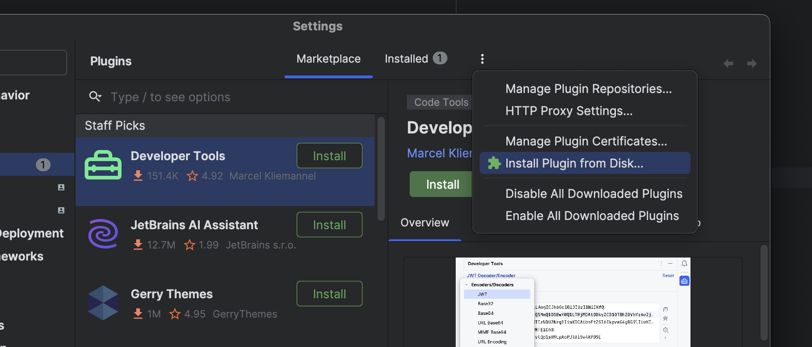
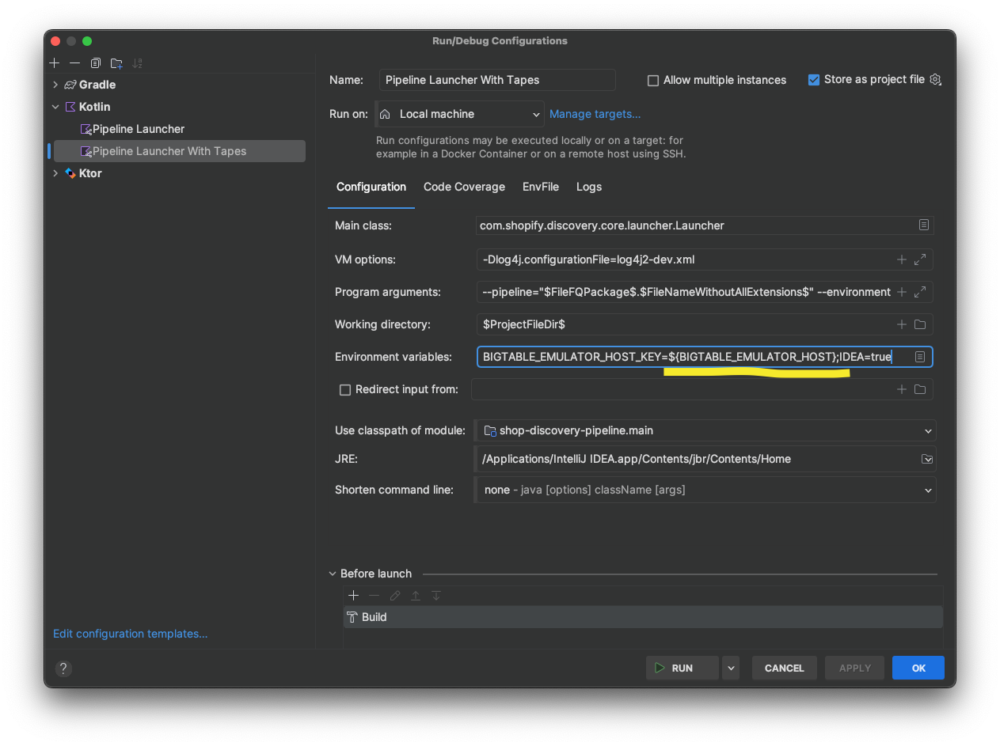
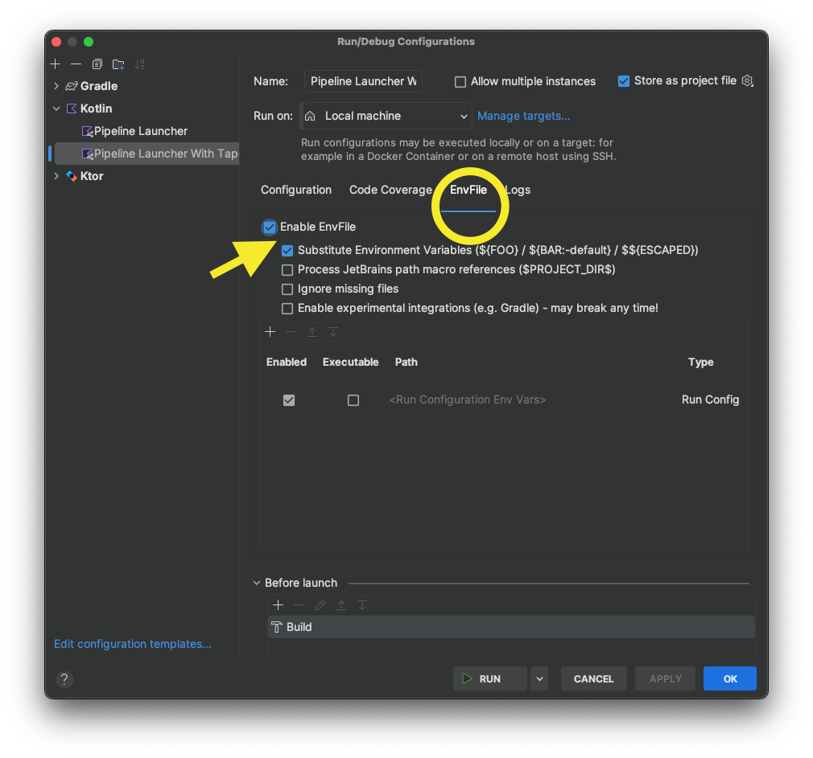

# Shadowenv

## Description

**Shadowenv** is a plugin that will automatically evaluate `shadowenv` in the
current projects base path, and automatically inject all set environment
variables into the active Run Configuration.

When using RubyMine, it will also look for the `RUBY_VERSION` variable and try
to set the SDK for the current Run Configuration to be one that matches that version.

## Installation

To install, download the latest version of the plugin (zip file) from the [Releases](https://github.com/Shopify/shadowenv/releases) page and install it in JetBrains IDE. On the plugins page, click the gear icon and select "Install plugin from disk".



You will also need to install the [EnvFile plugin](https://github.com/ashald/EnvFile). This is available in the JetBrains plugin repository.

To use the plugin, you can use variables from your shadowenv file in your run configuration. The syntax looks like `${VARIABLE_NAME}`. See an example here: 



You will need to enable the envfile plugin as well. See the example below:



## Building

EnvFile uses Gradle for building.

```bash
$ ./gradlew clean test build
  
  BUILD SUCCESSFUL in 22s
  59 actionable tasks: 59 executed
  
$ ls -1 build/distributions
  Shadowenv-0.0.1-SNAPSHOT.zip
```

In order to open plugin's project in IDE one should generate skeleton and then open it and import Gradle project:
```bash
$ ./gradlew setup
  
  BUILD SUCCESSFUL in 1s
  3 actionable tasks: 3 executed
```
This generates a very basic `.idea` project definition that is sufficient enough to ensure that IDEA would recognize
this as a plugin after Gradle import.

## Feedback

Any feedback, bug reports and feature requests are highly appreciated!


## Thanks

A big thanks goes to the [EnvFile plugin](https://github.com/ashald/EnvFile) for providing a
starting point for this plugin

## License

- Copyright (c) 2017 Borys Pierov. See the [LICENSE](./LICENSE) file for license rights and limitations (MIT).
- Copyright (c) 2019 Shopify Inc
